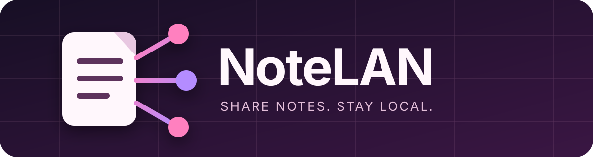

<p align="center">
  
</p>

<p align="center">
  <a href="https://github.com/OlivierLB/NoteLAN/actions/workflows/ci.yml"></a>
  <a href="https://github.com/OlivierLB/NoteLAN/releases"></a>
  <a href="LICENSE"></a>
  <a href="https://github.com/OlivierLB/NoteLAN/issues"></a>
</p>

<p align="center"><strong>Share selected Obsidian notes on your local network — no cloud, no account, read-only.</strong></p>

<p align="center"><a href="README.fr.md">Lire en français</a></p>

## Why NoteLAN?

NoteLAN turns selected Markdown notes and folders into clean web pages that phones, tablets, and computers on the same private network can open. The server runs inside the Obsidian desktop app and stops when you stop it or close Obsidian.

Nothing is uploaded to an external service.

## Features

- Share one note or an entire folder from Obsidian.
- Browse shared content through a responsive folder index.
- Render headings, lists, tables, code blocks, links, embeds, images, audio, video, and PDFs.
- Protect shared URLs with an optional secret token, enabled by default for new installations.
- Track local anonymous views and approximate unique visitors per page without storing IP addresses.
- Choose a theme, accent color, content width, font, path visibility, and custom CSS.
- Use English by default or French automatically when Obsidian uses a French locale.
- Optionally start with Obsidian or stop the server after a configured duration.
- Keep all settings and statistics inside the local plugin data file.

## Quick start

1. Enable NoteLAN in **Settings → Community plugins**.
2. Open a Markdown note.
3. Select the NoteLAN ribbon icon or run **Share current note locally**.
4. Send the copied URL to a device connected to the same local network.
5. Stop sharing from NoteLAN settings when finished.

Folders can be shared from the file explorer context menu or from NoteLAN settings. New files added inside a shared folder become available automatically.

## Privacy and network security

NoteLAN is designed for trusted local networks:

- the HTTP server only accepts loopback, private IPv4, and link-local IPv6 addresses;
- shared content is read-only;
- only explicitly shared notes, folders, and referenced media are served;
- URL tokens are never written to analytics;
- visitor IP addresses are never stored;
- anonymous visitors use a random `HttpOnly`, `SameSite=Strict` cookie whose salted hash is retained locally;
- security headers disable framing, referrers, forms, external scripts, and content-type sniffing.

Local HTTP traffic is not encrypted. Do not use NoteLAN on an untrusted or public network, and only share content that other devices on that network may read. See [SECURITY.md](SECURITY.md) for reporting vulnerabilities.

## Anonymous statistics

Statistics are local and can be disabled or reset at any time. NoteLAN records:

- total page views;
- approximate unique browsers/devices;
- views and unique visitors for each note or folder index;
- today's views and the last access time.

Visits from the computer running Obsidian are ignored by default. Anonymous identifiers can be retained for 7, 30, 90, or 365 days; cumulative view totals remain until statistics are reset.

## Installation

### Community plugin directory

Submission is in preparation. Once accepted, install NoteLAN from **Settings → Community plugins → Browse**.

### Manual installation

1. Download `main.js`, `manifest.json`, and `styles.css` from the [latest release](https://github.com/OlivierLB/NoteLAN/releases/latest).
2. Create `<vault>/.obsidian/plugins/local-note-share/`.
3. Copy the three files into that folder.
4. Reload Obsidian and enable **NoteLAN**.

The technical plugin ID remains `local-note-share` to preserve compatibility with existing installations.

## Compatibility

- Obsidian `1.13.0` or newer
- Desktop app only (Windows, macOS, or Linux)
- A private local network shared by the host and visitor devices

## Development

```bash
npm ci
npm run validate
```

`npm run validate` runs TypeScript checks, Obsidian-specific linting, tests, the production build, and a CommonJS smoke test. The production bundle is written to `main.js`.

See [CONTRIBUTING.md](CONTRIBUTING.md) for the contribution workflow and [CHANGELOG.md](CHANGELOG.md) for release history.

## License

NoteLAN is released under the [MIT License](LICENSE).

Created by [OlivierLB](https://github.com/OlivierLB).
